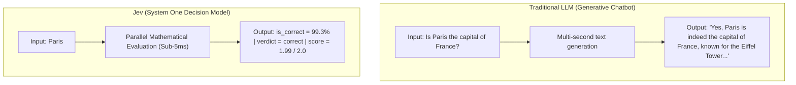
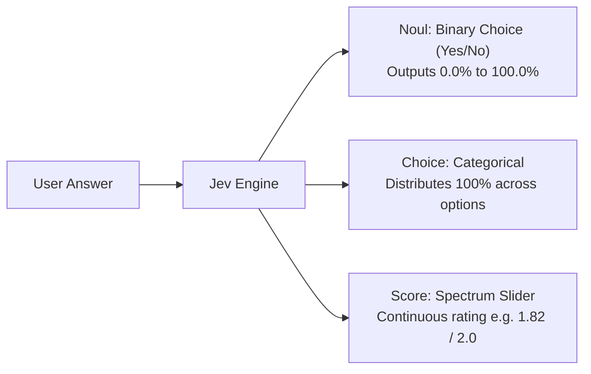

# Jev Made Simple

A hands-on, beginner-friendly demonstration of TypeSafe AI's Jev architecture. This repository demonstrates how "System One" decision models evaluate user inputs and return calibrated probabilities rather than generating open-ended conversational text.

---

## 1. What is Jev? (The Simple Non-Technical Analogy)

To understand Jev, think of human decision-making, as described by psychologist Daniel Kahneman:

* **System 2 (Slow, Deep Thinking):** When asked to solve a multi-step calculus problem or write a novel, you pause, deliberate, and formulate thoughts step-by-step. Traditional Large Language Models (like ChatGPT or Claude) work this way: they generate sentences word-by-word.
* **System 1 (Instant Reflex):** When you see a ball flying toward your face, you duck immediately without writing an essay in your head. When a teacher asks "Is Paris the capital of France?", your brain recognizes the answer in milliseconds. 

**Jev is an artificial System 1 reflex engine.** It does not write essays, generate chat messages, or output conversational filler. Instead, it takes an input and evaluates pre-defined questions in parallel, giving you back numbers, percentages, and decisions.



---

## 2. The Three Core Primitives

Jev structures all decisions around three simple question types:



### 1. Noul (True / False Probability)
* **Real-World Analogy:** A lie detector or confidence gauge.
* **What it does:** Returns a probability between 0.0 and 1.0 (0% to 100%) indicating how certain the model is about a statement.
* **Example in this project:** *"Is this answer factually correct?"* $\rightarrow$ **99.3%** for "Paris", **0.7%** for "London".

### 2. Choice (Categorical Selection)
* **Real-World Analogy:** A multiple-choice exam where the teacher calculates the likelihood of each option.
* **What it does:** Evaluates discrete options and spreads a full 100% probability across them using mathematical Softmax normalization.
* **Example in this project:**
  * Option A (Accurate): 98.9%
  * Option B (Partially Correct): 1.1%
  * Option C (Incorrect): 0.0%

### 3. Score (Continuous Quality Spectrum)
* **Real-World Analogy:** A volume knob or temperature gauge that slides smoothly between points.
* **What it does:** Instead of only picking a whole number (like 0, 1, or 2), it outputs a continuous floating-point number representing where the answer falls between levels.
* **Example in this project:** An answer with minor omissions receives a score of **1.00**, while a complete answer receives a **1.99** out of 2.00.

---

## 3. How This Code Simplifies Jev

In industrial applications, Jev is used for complex enterprise workflows like routing financial transactions or screening security threats. This project strips away unnecessary complexity and reduces Jev to its clearest form: **an interactive answer verification engine**.

1. **Self-Contained Implementation:** The probability math is implemented directly in pure Python (`jev_engine.py`) using standardized Softmax, Sigmoid, and Expectation algorithms. It runs offline on standard hardware without mandatory paid API keys or cloud dependencies.
2. **Dual Interfaces:**
   * **Web Dashboard:** An interactive web UI with real-time visual probability dials, Softmax bars, and continuous sliders.
   * **Terminal CLI:** A straightforward shell script for fast interactive testing.
3. **Pluggable Architecture:** If an official TypeSafe API key (`TYPESAFE_API_KEY`) is provided, the engine automatically routes to the official cloud Jev model.

---

## 4. Key Advantages of the Jev Scenario

| Advantage | Why It Matters |
| :--- | :--- |
| **Zero Format Hallucinations** | Generative LLMs often output broken JSON, markdown backticks, or extra commentary that crashes software pipelines. Jev outputs strictly typed numbers and booleans that programs can immediately branch on. |
| **Sub-5ms Execution Speed** | Generative models take 2 to 8 seconds to stream tokens. Jev processes decisions in single-digit milliseconds, making it suitable for live UI events and high-throughput gateways. |
| **Calibrated Confidence** | Instead of guessing whether an AI is confident, Jev provides mathematical probability distributions. Applications can establish strict thresholds (e.g. only auto-approve actions if certainty > 95%). |
| **Compute & Cost Efficiency** | Massive 70-billion-parameter text generators require high-end GPUs. Decision models require a fraction of the compute and memory, lowering operational costs. |
| **System 1 / System 2 Tiering** | Allows software systems to use fast decision models for 90% of routine triage and validation, escalating only the most complex 10% of tasks to expensive generative models. |

---

## 5. Project Layout

```
jev-made-simple/
├── jev_engine.py       # Core probability calculations (Noul, Choice, Score)
├── server.py           # HTTP backend server with API endpoints
├── cli.py              # Interactive command-line quiz interface
├── test_jev.py         # Automated verification tests
├── run.sh              # One-click launcher
└── static/
    ├── index.html      # Visual dashboard layout
    ├── style.css       # Clean styling and responsive layout
    └── app.js          # Interactive UI and gauge rendering
```

---

## 6. Getting Started

### Prerequisites
* Python 3.8 or higher
* Modern web browser (Chrome, Firefox, Safari, Edge)

### Option A: Launch the Web Dashboard
```bash
./run.sh
# Or run directly: python3 server.py 8000
```
Open **http://127.0.0.1:8000** in your browser.

### Option B: Run in Terminal Mode
```bash
python3 cli.py
```

### Option C: Run Automated Tests
```bash
pytest test_jev.py
```
